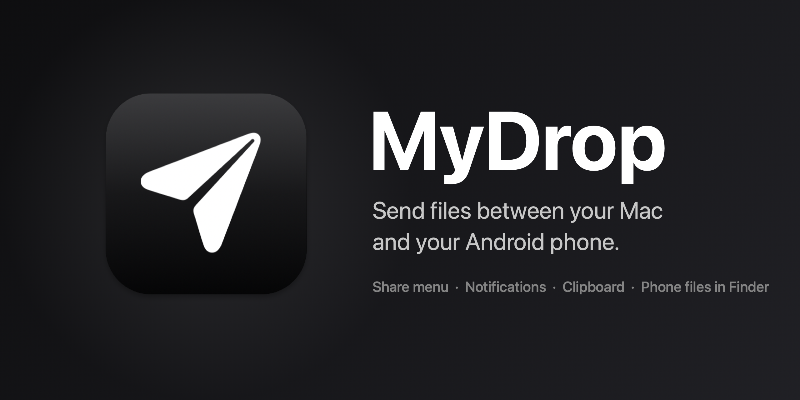
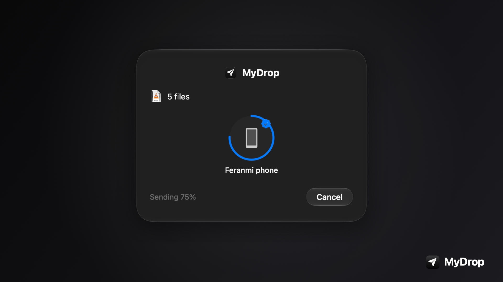
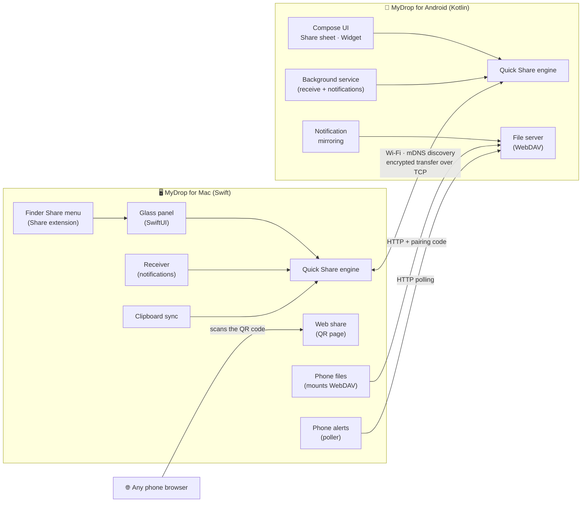
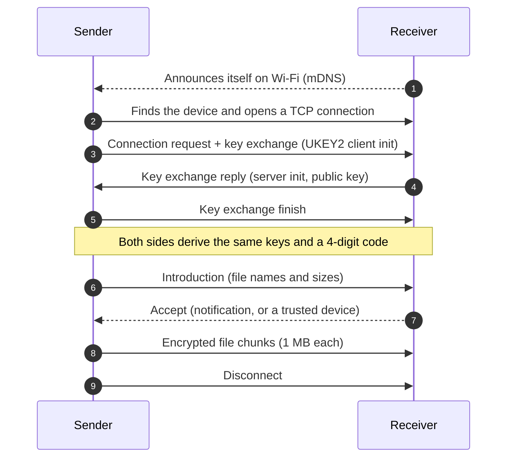

<p align="center">
  
</p>

<p align="center">
  <a href="https://github.com/Ferousco-dev/mydrop/releases/download/macos-v1.0.0/MyDrop-macOS.zip"></a>
  &nbsp;&nbsp;
  <a href="https://github.com/Ferousco-dev/mydrop/releases/download/android-v1.0.0/MyDrop-Android.apk"></a>
</p>

<p align="center">
  
  
  
  
  
</p>

<p align="center"><b>A clean, native way to move files between a Mac and an Android phone over Wi-Fi.</b></p>

MyDrop speaks Quick Share, so it works with QuickDrop-compatible devices, and it adds a few things of its own: a Finder Share entry, notifications, a web page for people without the app, your phone's files in Finder, clipboard sync and notification mirroring.

## 👀 Preview

<p align="center">
  
</p>

The Mac and Android apps are released separately: see the [releases page](https://github.com/Ferousco-dev/mydrop/releases) for each.

## ✨ At a glance

| | | |
|:---:|:---:|:---:|
| 📤<br/>**Share menu**<br/>Right-click → Share → MyDrop | 🔔<br/>**Notifications**<br/>Accept, progress, received | 📁<br/>**Folders**<br/>Zipped and sent as one file |
| 📋<br/>**Clipboard**<br/>Send it, or sync it | 📱<br/>**Phone files**<br/>Your phone as a Finder drive | 🔳<br/>**Share by QR**<br/>For people without the app |
| ⭐<br/>**Trusted devices**<br/>No more tapping Accept | 🧩<br/>**Widget**<br/>One-tap receiving on Android | 🎨<br/>**Clean design**<br/>Liquid Glass and Apple colors |

## 📥 Install

**🖥️ Mac**
1. Download `MyDrop-macOS.zip`, unzip it and drag **MyDrop** into Applications.
2. The first time, right-click the app and choose **Open** (it is not notarized by Apple).
3. Allow Local Network access when macOS asks.
4. In Finder, right-click a file → **Share** → **MyDrop**. If it is missing, choose **Edit Extensions…** and tick it.

**📱 Android**
1. Download `MyDrop-Android.apk` on the phone and open it. Android asks you to allow installs from your browser or Files app once.
2. Open MyDrop and allow notifications.

Both devices need to be on the same Wi-Fi. A phone hotspot joined by the Mac also works, and is usually the fastest.

## 🧭 How it works



### 🔐 What happens when you send a file



Everything after the key exchange is encrypted (AES-256 with HMAC), the same way Google's Quick Share does it.

## 🚀 Features

### 🖥️ Mac
- 📤 **Share menu entry.** Right-click files or folders in Finder → Share → MyDrop. The app runs in the background with no Dock or menu bar icon. Opening it from Spotlight shows the panel.
- 🎨 **Liquid Glass panel.** One clean floating panel on macOS 26 and later (frosted fallback on macOS 14–15), with spring animation, Apple's system sounds and trackpad haptics. Respects Reduce Motion.
- ⭐ **Trusted devices.** Right-click a device → *Always Trust This Device*, and files go straight to it.
- 🔔 **Receiving with notifications.** An AirDrop-style notification with Accept, Always Accept and Decline, then a "Received" notification that opens the file in Finder. If notifications are off, a window asks instead.
- 📁 **Folders** are zipped and sent as one file.
- 📋 **Clipboard.** Right-click a device → *Send Clipboard*, or switch on **Clipboard sync** to send new clipboard text to your trusted phone automatically.
- 📱 **Phone files.** Opens the phone as a drive in Finder.
- 🔔 **Phone alerts.** Shows your phone's notifications on the Mac.
- 🔳 **Share by QR.** Shows a QR code for people without the app (see below).
- ⋯ The **"…" button** opens a clean screen with Phone files, Share by QR, Clipboard sync and Phone alerts.
- ⌨️ **Command line:** `MyDrop list`, `MyDrop send "<device>" file…`, `MyDrop serve`, `MyDrop browse`.

### 📱 Android
- 🎨 **Clean dark design** with Apple system colors, a collapsing Settings sheet, pull-down to refresh, and a progress card with live speed.
- 📡 **Live discovery** (Android 14+), and the phone hides its own listing.
- 📤 **Send** files, images, **folders** (zipped), clipboard text and anything from the system **Share sheet** (Gallery, Files, browsers).
- 📥 **Receive in the background** with notifications: accept prompt, progress and a "Received" notification with a picture preview. Files go to `Downloads/MyDrop`.
- ⭐ **Trusted senders** (*Always accept*), managed in Settings.
- 🧩 **Home-screen widget** that turns receiving on or off with one tap, and starts again after a reboot.
- ✏️ **Rename the phone** by tapping the "Visible as…" pill.
- 📂 **Let my Mac browse this phone** (read-only by default) and an optional **Allow editing** switch.
- 🔔 **Mirror Android notifications** to the Mac, and 📋 **Sync clipboard**.
- 🔋 **Optional background help** in Settings for phones whose battery manager pauses apps.

### 🔳 Without the app
On the Mac, *Share by QR* starts a small web page and shows a QR code. Anyone on the same Wi-Fi can scan it, send files to the Mac's `~/Share` folder and download what is in there, with no app installed. It runs only while the QR code is on screen, and every address contains a random token.

### 📂 Phone files in Finder
1. On the phone: Settings → switch on **Let my Mac browse this phone** (allow *All files access* once). Note the code.
2. On the Mac: open MyDrop → **Phone files** (or the "…" button) and enter the code once. It is kept in the Keychain.
3. The phone opens in Finder as a drive. It is read-only unless you switch on **Allow editing** on the phone.

The connection is plain HTTP on your Wi-Fi, so use it on a network you trust and turn it off when you are done.

## 🛠️ Build from source

You need the Xcode command-line tools (Swift 5.9+) for the Mac app, and a JDK 17+ with the Android SDK for the phone app. The full Xcode app is not required.

```bash
# Mac
./make-app.sh                      # builds MyDrop.app next to this file
cp -R MyDrop.app /Applications/ && open /Applications/MyDrop.app

# Android
cd android && ./gradlew assembleDebug
adb install -r app/build/outputs/apk/debug/app-debug.apk
```

## 🗂️ Project layout

| Path | What it is |
|---|---|
| `MyDrop/Sources/MyDrop` | Mac app: panel, receiving, web share, phone files, mirroring, command line |
| `MyDrop/Sources/MyDrop/NearbyShare` | Quick Share transfer engine (from QuickDrop) |
| `MyDrop/Sources/MyDrop/Stubs.swift` | Small stand-ins for helpers QuickDrop kept in a private library |
| `MyDrop/Sources/MyDropShare` | The Finder Share extension |
| `android/app/src/main/java/com/mydrop/android` | Android app |
| `…/engine` | Quick Share engine in Kotlin (key exchange, encryption, discovery) |
| `…/receive` | Background service, notifications, widget, trusted senders |
| `…/share` | File server (WebDAV), folder zipping, notification mirroring |
| `icon/`, `assets/` | Icon generators, the compiled icon, banner and download buttons |

## ⚠️ Notes and limits
- **Phones that pause background apps** (some Tecno/Transsion, Xiaomi and others) may need the battery steps in Settings → *Keep receiving in the background*. Without them the phone still receives whenever the app is open.
- **Clipboard sync:** Mac to phone works in the background. Phone to Mac works only while MyDrop is open, because Android does not let apps read the clipboard from the background. The phone must have set the Mac to *Always accept*.
- **Phone files** are unencrypted on the local network, and editing is off by default.
- A Mac can see other Quick Share receivers (a phone's built-in Quick Share set to "Everyone"), but a phone's built-in Quick Share usually cannot see a Mac, because that needs a Bluetooth announcement macOS cannot send.
- MyDrop has no paid tier, so the receiving limit the original engine applies to free users is switched off (`plusVersionState` in `Stubs.swift`). Set it to `false` to bring the limit back.
- The downloads are signed for sideloading only, so macOS and Android show a warning the first time.
- Speed depends mostly on the Wi-Fi link: a strong 5 GHz signal or a phone hotspot is the fastest.

## 🙏 Credits
The transfer engine comes from [QuickDrop](https://github.com/leonboe1/QuickDrop) by Leon Böttger, itself a fork of [NearDrop](https://github.com/grishka/NearDrop) by grishka. Both are released under the Unlicense (public domain). The protocol notes in NearDrop's `PROTOCOL.md` guided the Kotlin engine.

Quick Share and Nearby Share are trademarks of Google LLC and Samsung Electronics. Android is a trademark of Google LLC. Apple, Mac, macOS and Finder are trademarks of Apple Inc. This project is not affiliated with any of them or with the QuickDrop developer.

## 📄 License
Public domain (Unlicense), matching the projects it builds on.
